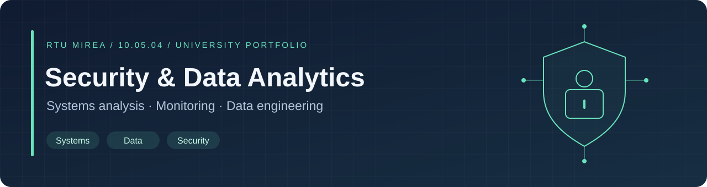

<p align="center">
  
</p>

# Бекхан Муратбеков · Учебное портфолио

**РТУ МИРЭА · Информационно-аналитические системы безопасности**

Изучаю моделирование угроз, управление доступом и анализ данных. В этом репозитории я собрал свои учебные проекты с исходниками, пояснениями решений и инструкциями запуска. Рассматриваю стажировки в области информационной безопасности и анализа данных для задач ИБ.

<p>
  
  
  
  
</p>

[Основные проекты](#основные-проекты) · [Другие лабораторные](#другие-лабораторные) · [Запуск и проверки](#запуск-и-проверки) · [Происхождение материалов](#происхождение-материалов)

## Основные проекты

### 01 · Контроль доступа в ASP.NET Core

REST API с разделением прав: `reader` просматривает записи, `admin` создаёт, изменяет и удаляет их. Вход с проверкой хеша пароля, cookie-аутентификация, CSRF-защита и ограничение попыток входа.

**Результат:** сборка .NET 10 и HTTP-проверки доступа, ролей, CSRF, валидации и CRUD выполнены локально.

[Описание и запуск →](portfolio/access-control-demo/README.md) · [Код →](portfolio/access-control-demo/Program.cs) · [Проверки →](tests/check_access_control.py)

### 02 · Модель угроз информационно-аналитической системы

Учебный кейс вымышленной проектной организации: архитектура, модель нарушителя, деревья угроз и экспертное ранжирование. Дополнен расчётной моделью попыток НСД с объяснением её допущений.

**Результат:** редактируемые схемы, обезличенная книга экспертных оценок и проверенный Python-расчёт. Полная нормативная проверка модели не проводилась.

[Описание кейса →](portfolio/ias-threat-model/README.md) · [Схемы и Excel →](portfolio/ias-threat-model/assets) · [Расчётная модель →](portfolio/ias-threat-model/poisson_model.py)

### 03 · Многокритериальный анализ на Python

Парето-оптимальность, Ω-доминирование, выбор главного критерия и метод последовательных уступок. Версия без внешних библиотек позволяет воспроизвести расчёты и получить CSV/JSON.

**Результат:** проверены допустимость решений, численные результаты и обработка доминирования. Извлечённые исторические листинги хранятся отдельно.

[Описание методов →](portfolio/multicriteria-analysis/README.md) · [Код →](portfolio/multicriteria-analysis/analysis.py) · [Пример результатов →](docs/examples/optimization.json)

### 04 · Анализ сетевого трафика в OpenSearch

Пайплайн `PCAP → TShark → CSV → OpenSearch`: преобразование типов, пакетная загрузка, повторяемые идентификаторы записей и поисковые запросы для анализа HTTP, DNS и сетевой активности.

**Результат:** конвертация и обработка ошибок проверены на синтетических данных. Docker-кластер и TShark в текущей среде не запускались.

[Описание и запуск →](portfolio/opensearch-traffic/README.md) · [Импорт данных →](portfolio/opensearch-traffic/import_traffic.py) · [Примеры запросов →](portfolio/opensearch-traffic/queries.http)

## Другие лабораторные

| Работа | Содержание | Статус |
|---|---|---|
| [Безопасность SQL Server](portfolio/database-security/README.md) | Роли, минимальные права, проверки разрешённых и запрещённых операций | Скрипты подготовлены; запуск на сервере не выполнен |
| [SQL-практикум](portfolio/sql-practice/README.md) | Учебные запросы PostgreSQL, точечные исправления решений | Исходная БД отсутствует; полного аудита запросов нет |
| [Хранилища данных](portfolio/storage-labs/README.md) | PostgreSQL, MongoDB, Redis, MinIO, Neo4j, Spark | Частичная реконструкция; сервисы требуют проверки |
| [Linux, HTTP и nginx](portfolio/linux-http-labs/README.md) | Basic Auth, конфигурация nginx, XHR и JSON | Конфигурация восстановлена; интеграционный запуск не выполнен |

## Запуск и проверки

Нужны Python 3.11+ и .NET SDK 10. Для основной расчётной версии внешние Python-библиотеки не требуются. Команды выполняются из корня репозитория:

```bash
# Численные методы и обработка данных: 12 тестов
python -m unittest discover -s tests -p test_reconstructed.py -v

# Сборка приложения и HTTP-проверки контроля доступа
dotnet build portfolio/access-control-demo/AccessControlDemo.csproj
python tests/check_access_control.py

# Пример многокритериального анализа
python portfolio/multicriteria-analysis/analysis.py --output output
```

[GitHub Actions](.github/workflows/checks.yml) содержит автоматические проверки Python и .NET при push и pull request. Их удалённый статус будет виден во вкладке **Actions** после загрузки репозитория.

## Происхождение материалов

Эти работы я выполнял во время обучения в РТУ МИРЭА. Часть исходников у меня не сохранилась. Для подготовки портфолио я использовал помощь ИИ: сохранившиеся листинги извлечены из моих отчётов, а недостающие реализации восстановлены по формулам, тексту и скриншотам. В README каждого проекта я указываю, что восстановлено, что изменено и какие проверки прошли.

Учебные примеры и сторонние источники указаны в документации проектов. Инфраструктура вымышленного предприятия и синтетические данные не представляют реальные системы или инциденты.

<details>
<summary>Подробнее о восстановлении и структуре</summary>

- [Журнал восстановления и ограничения](RESTORATION.md)
- [Карта файлов и способов запуска](docs/PROJECT_MAP.md)
- [Источники и авторство](docs/SOURCES.md)
- [Как опубликовать репозиторий и оформить профиль](docs/PUBLISHING.md)

Исходный университетский архив, резервные копии, секреты и результаты сборки исключены из публикации. Локальные скрипты первоначального извлечения требуют исходного архива и не нужны для запуска проектов.

</details>
