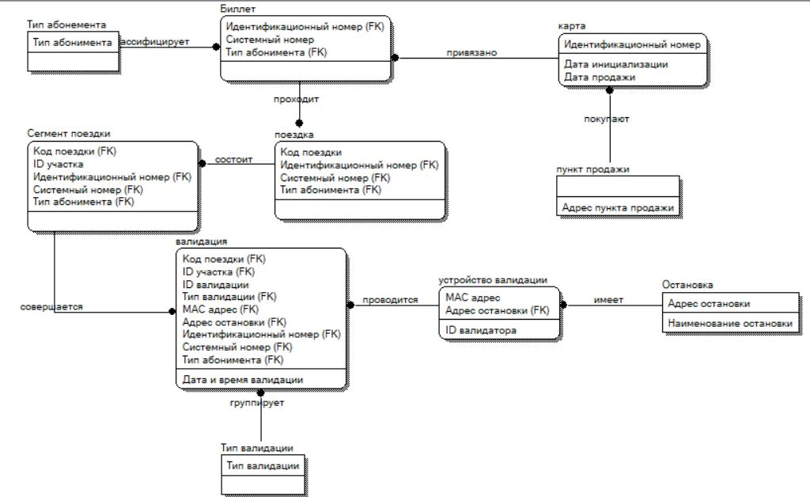

# Курсовая: модель учёта проездных билетов

В курсовой работе второго курса я рассматривал предметную область проездных билетов и использования транспортной карты. Задача включает продажу билетов, поездки, пересадки и фиксацию валидаций.

В описании предметной области выделены карта, билет, тип абонемента, поездка, её сегмент, валидация, устройство валидации, остановка и пункт продажи. Отдельно рассматриваются связи между сущностями и возможность нескольких частей в одной поездке.

Это сохранённая схема из моей работы, а не заново спроектированная или независимо проверенная модель. По ней можно обсудить выбор сущностей и ключей, кардинальности и избыточность связей. Корректность всех решений на схеме отдельно не подтверждалась.

Работа связана с системной аналитикой и проектированием данных. Сохранившийся текст описывает концептуальное и информационно-логическое моделирование; готовая реализация БД, DDL, тестовые данные и приложение в этой публикации не заявляются.

[SQL-практикум](../sql-practice/README.md) · [К общей карте подготовки](README.md) · [Источники](PROVENANCE.json)
